<div align="center">




<br>

[**GitHub**](https://github.com/youknowumer) &nbsp;·&nbsp; [**LinkedIn**](https://linkedin.com/in/youknowumer) &nbsp;·&nbsp; [**Email**](mailto:umerfaheem632@gmail.com) &nbsp;·&nbsp; [**WhatsApp**](https://wa.me/923258148564)

</div>

<br>



A single-page portfolio at the intersection of **frontend development, user experience design, business intelligence and ERP**. It is built as a personal brand site rather than a résumé page: visitors explore my background, skills, experience, education, awards, documents and contact details through a premium **Liquid Glass** interface with smooth, considered motion.

<div align="center">

</div>

<br>


| | |
|---|---|
| **Liquid Glass UI** | Frosted panels, specular highlights, soft depth and refraction-style gradients |
| **Fluid motion** | Staggered reveals, smooth scrolling, tilt interactions and an animated hero |
| **Skills visualisation** | Live radar chart and animated proficiency bars |
| **Role-based experience** | Role rail with one detail panel at a time; arrow keys, Home and End navigate |
| **Command palette** | `Ctrl/⌘ + K` for quick navigation and keyboard shortcuts |
| **AI assistant** | Chat panel backed by a structured knowledge base (`js/data.js`) |
| **Documents** | CV and cover-letter preview modal with PDF download |
| **Responsive** | Desktop tab bar becomes a floating bottom dock on screens up to 768px |
| **Graceful fallback** | Without JavaScript every experience role is shown stacked |

<br>


<div align="center">

<br>

</div>

<br>


| Section | What it shows |
|---|---|
| **About** | Background, working style, delivery approach and journey timeline |
| **Skills** | Domain proficiency, radar chart and tool-level scores |
| **Experience** | Roles (newest first) with period, time in role, setting, responsibilities and tools |
| **Education** | BBIS credential card with semester progress and a ledger linking studies to applied work |
| **Awards** | Honours, leadership and credentials, each tagged with `data-tier` |
| **Projects** | Selected work, technologies, roles and outcomes |
| **Resume** | CV and cover letter preview and download |
| **Contact** | Form, WhatsApp, LinkedIn, GitHub and map |

<br>


```text
MyPortfolio/
├── index.html                # markup only
├── css/                      # base, glass layers, sections, tab bar (order matters)
│   ├── base.css              # variables, layout, sections, responsive rules
│   ├── glass-theme.css · liquid-glass.css · ios-glass.css · tab-glass.css · edge-blur.css
│   ├── premium.css · upgrade.css · polish.css · effects.css · sparkles.css
│   ├── tabbar.css            # tab bar (desktop header + mobile dock)
│   ├── about.css · skills.css · dial.css · experience.css · education.css · awards.css
│   └── documents.css · ai-chat.css · back-to-top.css
├── js/
│   ├── data.js               # generated structured data (do not edit by hand)
│   ├── core.js · main.js · smooth.js
│   ├── effects.js · radar-chart.js · premium.js · upgrade.js · dial.js
│   ├── tabbar.js · tab-glass.js · edge-blur.js
│   ├── about.js · skills.js · experience.js
│   └── documents.js · ai-chat.js
├── scripts/
│   ├── extract-data.py       # index.html → js/data.js
│   ├── validate.mjs          # data validation
│   └── build-readme-assets.py  # regenerates the animated README graphics
└── assets/
    ├── images/               # Logo.png, profile.jpg
    ├── docs/                 # CV and cover-letter PDFs
    └── readme/               # animated liquid-glass SVGs used in this README
```

Stylesheets and scripts load in the order listed in `index.html` — keep that order.

**Workflow**

```bash
npm run data     # regenerate js/data.js after editing roles or awards in index.html
npm run check    # syntax-check every script and validate the data
python3 scripts/build-readme-assets.py assets/readme   # rebuild README animations
```

**Tab bar.** The navigation is a dark pill: every tab has an outline icon, and the active tab expands into a white pill with a filled icon and label. All colours and sizes are variables at the top of `css/tabbar.css` (`--tab-bar-bg`, `--tab-active-bg`, `--tab-size`, …). To add a tab, add an `<li>` to `#navLinks` in `index.html`; `js/tabbar.js` picks it up automatically.

<br>


**Principles:** minimal but impactful layouts · strong visual hierarchy · smooth interactions · consistent spacing · accessible design · performance.

| Token | Value | Use |
|---|---|---|
| `--bg` | `#FDF6EE` | Page background |
| `--text` | `#1A1008` | Primary text |
| `--muted` | `#8A6840` | Secondary text |
| `--gold` | `#E8851A` | Accent |
| `--green` / `--green-dk` | `#D4813A` / `#A85E22` | Brand copper |
| `--dark` | `#150A02` | Deep contrast |

The README graphics use a complementary dark glass palette: `#070A12` base with gold `#FFB84D`, blue `#38BDF8` and purple `#A78BFA` accents.

> The README animations are pure SVG (CSS + SMIL, no JavaScript or external fonts), so they animate directly on GitHub and respect `prefers-reduced-motion`.

<br>


**All Rights Reserved.** This repository contains original code, design and content created by **Muhammad Umer Faheem**. It may not be copied, redistributed, reused as a template, modified for commercial purposes or republished under another identity without prior written permission from the author. See [LICENSE](LICENSE).

<br>

<div align="center">

If this project inspired you, a ⭐ is always appreciated.



</div>
